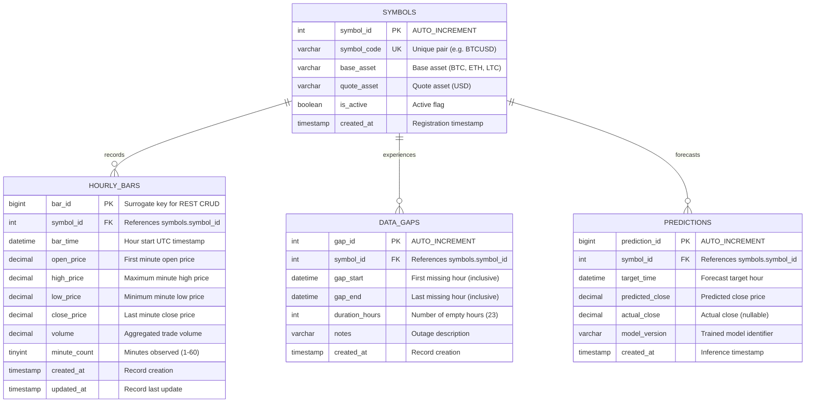

# Entity-Relationship Diagram (ERD) - Crypto Pipeline Database

This document details the relational structure of the `crypto_pipeline` MySQL database and provides step-by-step instructions to generate and export the official visual diagram using **MySQL Workbench** on Windows.

---

## 1. Visual Diagram (Mermaid Representation)

---

## 2. Step-by-Step Instructions: Generate ERD in MySQL Workbench (Windows)

Follow these steps in **MySQL Workbench** to generate the official EER diagram and export it:

### Step 2.1: Open the Reverse Engineer Wizard
1. Open **MySQL Workbench**.
2. Connect to your local MySQL server instance where `crypto_pipeline` was created.
3. In the top navigation menu, click **Database** $\rightarrow$ **Reverse Engineer...** (or press `Ctrl + R`).

### Step 2.2: Select the Connection
1. In the **Parameters** window, verify your connection parameters (Host: `127.0.0.1` / Port: `3306` / User: `root`).
2. Click **Next**, enter your MySQL password if prompted, and click **Next** when the tasks succeed.

### Step 2.3: Select the Database Schema
1. Check the box for **`crypto_pipeline`**.
2. Click **Next**, and wait for Workbench to retrieve the schema objects. Click **Next** again.

### Step 2.4: Select Objects to Import
1. Ensure **Import MySQL Table Objects** is checked (all 4 tables: `symbols`, `hourly_bars`, `data_gaps`, `predictions`).
2. Click **Execute**. Workbench will import the metadata and reverse-engineer the relational model.
3. Click **Next**, then click **Finish**.

### Step 2.5: Adjust Layout in the Diagram Canvas
1. MySQL Workbench will open a new tab titled **`EER Diagram`**.
2. Drag the tables to arrange them cleanly:
   - Place **`symbols`** at the top or center.
   - Connect **`hourly_bars`**, **`data_gaps`**, and **`predictions`** radiating outward from `symbols`.
3. Notice the crow's foot notation representing the **1-to-many ($1:N$)** relationships.

### Step 2.6: Export the Diagram Image
1. Click **File** $\rightarrow$ **Export** $\rightarrow$ **Export as PNG...**
2. In the file dialog, navigate to your repository's ERD directory:
   `C:\Users\user\ml-pipeline-formative1\database\erd\`
3. Save the image as **`erd.png`** (or `erd.svg` / `erd.pdf` if preferred).
4. Verify that `database/erd/erd.png` is now created in your project.

---

## 3. Relational Architecture & Cardinality Rationale

### Central Dimension: `symbols`
- **Role**: Master lookup entity.
- Every financial candlestick, exchange outage, and forecast must belong to a known, valid trading symbol.

### 1-to-Many Relationships ($1 : N$):
1. **`symbols` $\rightarrow$ `hourly_bars` ($1 : N$)**:
   - One symbol (e.g., `BTCUSD`) has tens of thousands of hourly bars over time ($N$).
   - Each hourly bar corresponds to exactly one symbol.
2. **`symbols` $\rightarrow$ `data_gaps` ($1 : N$)**:
   - One symbol experiences multiple outage events (18 separate 23-hour outages in our dataset).
   - Each outage record belongs to a specific symbol.
3. **`symbols` $\rightarrow$ `predictions` ($1 : N$)**:
   - One symbol receives multiple forecast points from trained models.

### Referential Integrity Constraints:
- **`ON DELETE RESTRICT`**: Prevents deleting a symbol from `symbols` if historical price bars or outages still exist in `hourly_bars` or `data_gaps`. This protects valuable financial history from accidental deletion.
- **`ON UPDATE CASCADE`**: If a `symbol_id` is ever modified in the parent table, the update automatically cascades to all child records, preserving link integrity.
